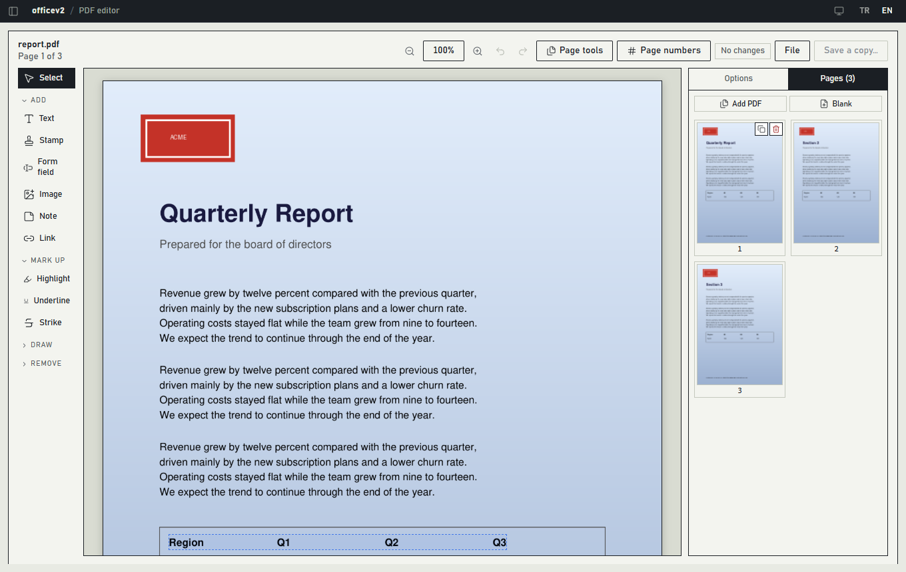
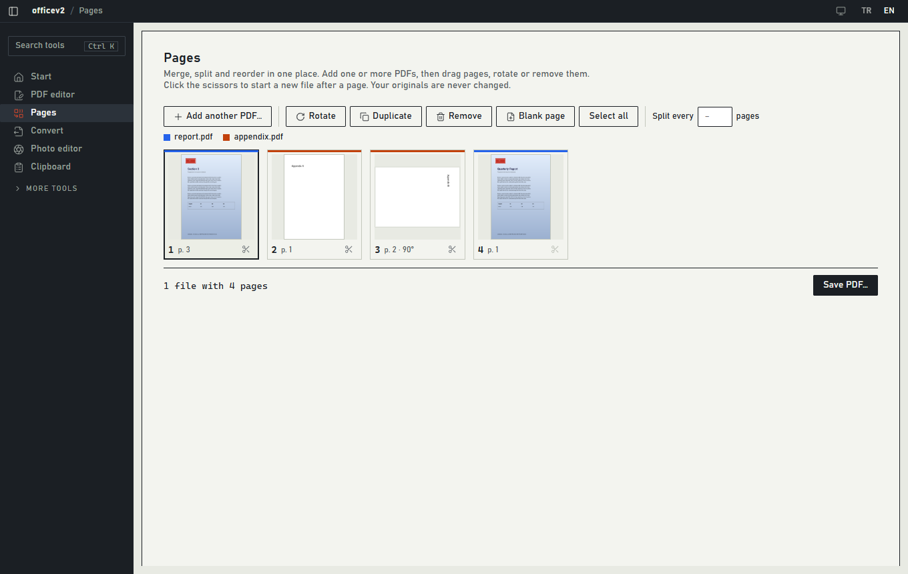
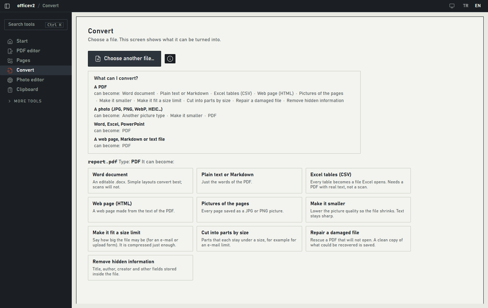
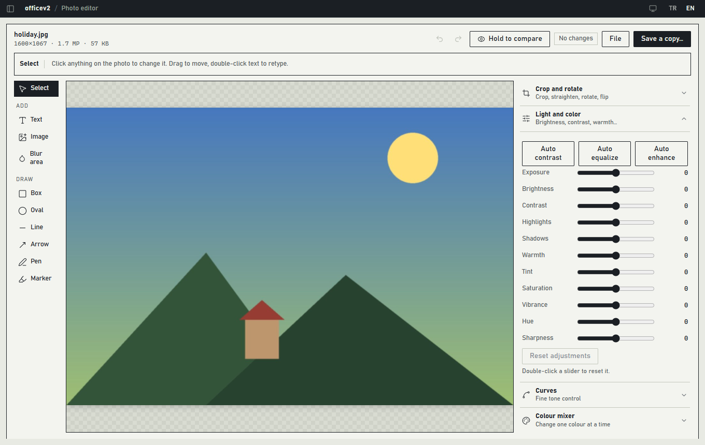
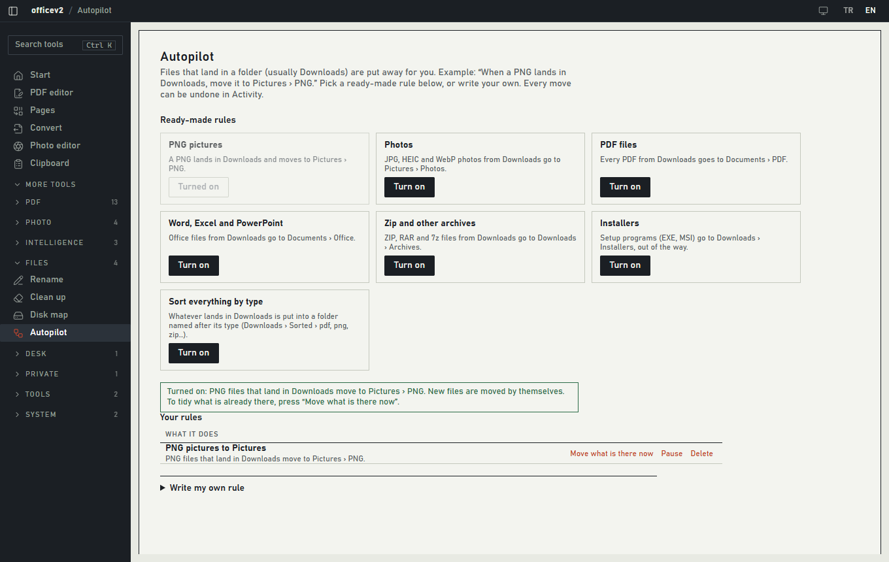

# officev2

**Kendi bilgisayarında çalışan PDF ve fotoğraf araçları.** Bir PDF'i Word dosyası gibi düzenle, sayfaları birleştir ve böl, dosyaları dönüştür, fotoğrafı düzelt ve her programdan açabileceğin bir pano geçmişi tut. Hesap yok, bulut yok, izleme yok. Dosyaların bilgisayarından çıkmaz ve orijinallerin asla değişmez.

[English](README.md) · [Mimari](ARCHITECTURE.md) · [Tasarım notları](DESIGN.md)



## İndir

Kurulum dosyasını [Releases](../../releases) sayfasından indir, çalıştır, bitti. Uygulamanın ihtiyacı olan her şey içinde; kurulum sırasında hiçbir şey indirilmez. Windows 10 veya 11 (64 bit).

- Yalnızca bulunduğun kullanıcı için kurulur, yönetici izni gerekmez.
- Kurulum dosyası kod imzalı değil, bu yüzden Windows SmartScreen "bilinmeyen yayıncı" diyebilir. *Daha fazla bilgi* ve *Yine de çalıştır*'ı seç.
- Ağır ekstralar (fotoğraf arka planı silme, konuşmayı yazıya çevirme, belgelerinde anlama göre arama) istediğinde uygulamanın içinden kurduğun isteğe bağlı eklentilerdir.

## Neler yapabilirsin

| | |
|---|---|
| **PDF editörü** | Bir PDF aç, sayfadaki herhangi bir yazıya tıklayıp yeniden yaz. Altındaki arka plan, resim ve çizimler olduğu gibi kalır. Yazıyı ve resimleri sürükle, logoyu sil, yazı, damga, imza, resim, not, bağlantı ve form alanı ekle, kelimeleri vurgula, çiz, özel bilgileri kalıcı olarak karart, sayfa numarası ekle, sonra bir kopya kaydet. |
| **Sayfalar** | Bir ya da birkaç PDF ekle, her sayfa bir kutucuk olarak görünür. Sürükleyerek sırala, döndür, kaldır, çoğalt, boş sayfa ekle, makasa tıklayıp sonucu birkaç dosyaya böl. |
| **Dönüştür** | Bir dosya seç, neye dönüşebileceğini göstersin. PDF için: Word, yazı ya da Markdown, Excel tabloları, web sayfası, sayfa resimleri, küçültme, boyut sınırına sığdırma, boyuta göre bölme, onarma, gizli bilgileri silme. Fotoğraf için: başka resim türü, küçültme, PDF. Word, Excel, PowerPoint ve web sayfaları için: PDF. |
| **Fotoğraf editörü** | Kırp, düzelt, ışık ve renk, eğriler, canlı önizlemeli filtreler, yazı, şekiller, yüz ya da plaka bulanıklaştırma, çerçeve, QR kod, sonra kaydet. Her değişiklik kaldırabileceğin bir adımdır. |
| **Pano** | Herhangi bir programdayken `Ctrl+Shift+V`'ye bas, son 100 kopyan (yazı, bağlantı, renk, resim) imlecin yanında açılır, Enter ile yapıştır. Tepside çalışır ve Windows ile başlayabilir. Parola yöneticisinin gizli işaretlediği hiçbir şey kaydedilmez. |
| **Sağ tık** | PDF ve resimlerde *officev2 ile düzenle* ve *officev2 ile dönüştür*. Birden çok PDF seçince Sayfalar'da açılır. |
| **Diğer araçlar** | Kalıpla karartma (e-posta, IBAN, TC kimlik, telefon, kart), filigran, parola koruması, tarama için OCR, iki PDF'i karşılaştırma, taramayı temizleme, baskı düzeni, dijital imza, klasör başına toplu işler, vesikalık, sosyal medya boyutları, kolaj ve GIF, toplu yeniden adlandırma, çöp ve kopya temizliği, indirdiklerini ayıran Otopilot kuralları, şifreli kasa. |

<table>
<tr>
<td></td>
<td></td>
</tr>
<tr>
<td></td>
<td></td>
</tr>
</table>

Arayüz Türkçe ve İngilizce (üstteki TR / EN ile değişir), Windows'un açık ya da koyu ayarını izler; tema düğmesiyle de seçebilirsin.

## Dosyalarını nasıl korur

- **Orijinaller asla değişmez.** Araçlar bir kopya kaydeder ve var olan dosyanın üzerine yazmaz.
- **İşlemler geri alınabilir.** Oluşturulan dosyalar çöp klasörüne taşınır, taşınan ya da adı değişen dosyalar yerine döner, kaldırılanlar karantinada bekler. Etkinlik ekranına bak.
- **Motor yalnızca uygulamaya aittir.** Python motoru yalnızca `127.0.0.1`'de rastgele bir portta dinler, oturuma özel jeton ister ve yabancı tarayıcı kaynaklarını reddeder.
- **Arkandan hiçbir şey indirilmez.** Modeller ve eklentiler yalnızca sen isteyince, boyutu söylendikten sonra iner.

## Kendin derle

Windows 10/11, Python 3.12, Node.js 22, Rust (kararlı sürüm, MSVC derleme araçlarıyla) ve WebView2 gerekir.

Kaynaktan çalıştır:

```powershell
git clone https://github.com/beyuphan/officev2.git
cd officev2

cd backend
python -m venv venv
.\venv\Scripts\python.exe -m pip install -r requirements.txt
cd ..\frontend
npm install
npm run tauri dev          # uygulamayı açar, o da Python motorunu backend\venv'den başlatır
```

Kurulum dosyasını üret:

```powershell
python scripts\build_engine.py        # bir kez ve backend değiştikçe: frontend\src-tauri\engine-dist'i yapar (yaklaşık 400 MB, Python'u indirir)
cd frontend
npm run tauri build -- --bundles nsis # sonuç: frontend\src-tauri\target\release\bundle\nsis\
```

| Değişken | Ne işe yarar |
|---|---|
| `LOCALFLOW_DATA_DIR` | Ayarların, geçmişin, modellerin ve kasanın durduğu yer (varsayılan `%APPDATA%\officev2`) |
| `LOCALFLOW_ALLOWED_ROOTS` | Motorun okuyup yazabildiği klasörler (varsayılan: kullanıcı klasörün ve sürücülerin) |
| `LOCALFLOW_BACKEND_DIR`, `LOCALFLOW_PYTHON` | Kaynaktan çalışırken başka bir motor klasörü ya da Python kullan |

## Testler

```powershell
cd backend;  .\venv\Scripts\python.exe -m pytest -m "not network"   # motor
cd frontend; npm test                                              # arayüz mantığı
cd frontend; npm run test:e2e                                      # gerçek motor ve gerçek arayüz, Edge'de
cd frontend\src-tauri; cargo test --lib                            # pano deposu
```

`npm run test:e2e` gerçek arayüzü sürer (dosya pencereleri taklit edilir), gerçek dosyalar kaydeder ve sonucu kontrol etmek için tekrar açar. `node e2e/walkthrough.mjs` uygulamayı fare tıklamalarıyla gezer ve `e2e/walk-shots` içine ekran görüntüsü alır; bir kullanıcı gibi bakmak içindir.

## Klasörler

```
backend/    Python motoru (FastAPI): PDF, fotoğraf, medya, yapay zekâ, dosyalar, kasa, işler, geçmiş
frontend/   Tauri 2 kabuğu (Rust) ve React/TypeScript arayüzü, uçtan uca testler e2e/ içinde
scripts/    build_engine.py: kurulum dosyasına giren motor klasörünü hazırlar
docs/       Ekran görüntüleri
```

## Sınırlar

- Şimdilik yalnızca Windows. Pano penceresi, ekran araçları ve Windows OCR'ı Windows'a özeldir.
- PDF'te var olan bir yazıyı yeniden yazmak eski satırı siler ve yenisini en yakın kurulu yazı tipiyle yazar. Özgün yazı nesnelerini düzenlemez.
- Taranmış sayfalarda tıklanacak yazı yoktur; önce *Recognize text* (OCR) çalıştır.
- Uygulamayı hafif tutmak için yapılmadı: katmanlar ve fırçalar, yapay zekâlı silme, RAW ve PSD, PDF/A, PDF'ten PowerPoint'e, video araçları.
- Pano geçmişi henüz şifrelenmemiş yerel bir veritabanında durur.

## Lisans

[GNU Affero Genel Kamu Lisansı v3.0](LICENSE). PDF motoru PyMuPDF AGPL lisanslı, bu yüzden bu proje de öyle: serbestçe kullanabilir, değiştirebilir ve paylaşabilirsin; değiştirilmiş bir sürümü verdiğin (ya da ağ üzerinden kullandırdığın) herkes kaynağını da alır.
