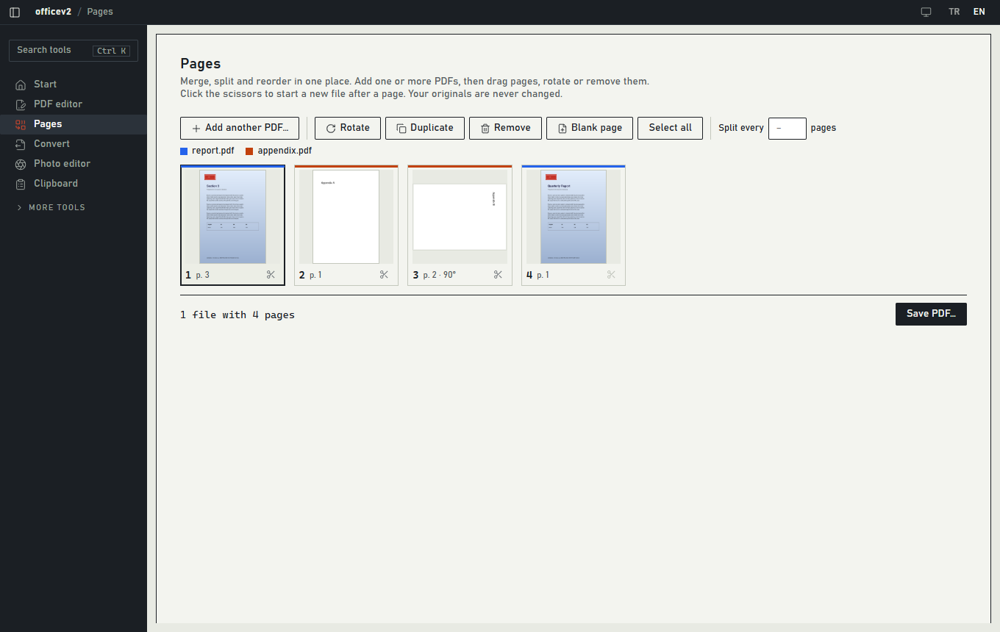
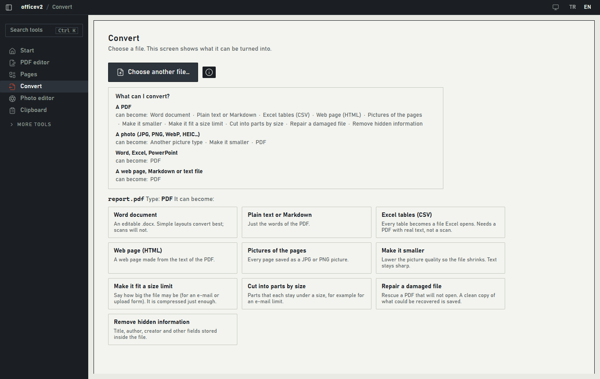
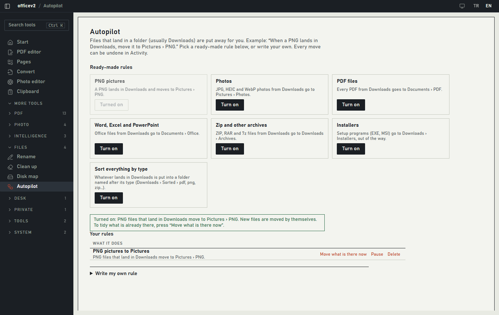

# officev2

**PDF and photo tools that run on your own computer.** Edit a PDF the way you edit a Word file, merge and split pages, convert files, fix a photo, and keep a clipboard history you can open from any program. No account, no cloud, no telemetry. Your files never leave your machine and your originals are never changed.

[Türkçe](README-tr.md) · [Architecture](ARCHITECTURE.md) · [Design notes](DESIGN.md)


## Download

Get the installer from the [Releases](../../releases) page, run it, and you are done. Everything the app needs is inside; nothing is downloaded while you install. Windows 10 or 11 (64-bit).

- It installs for the current user only, no administrator rights needed.
- The installer is not code-signed, so Windows SmartScreen may say "unknown publisher". Choose *More info* and *Run anyway*.
- Heavier extras (removing photo backgrounds, speech to text, searching your documents by meaning) are optional add-ons you install from inside the app when you want them.

## What you can do

| | |
|---|---|
| **PDF editor** | Open a PDF and click any text on a page to retype it. The background, pictures and drawings under it stay as they are. Drag text and pictures, delete a logo, add text, stamps, signatures, images, notes, links and form fields, highlight words, draw, black out private information for good, add page numbers, then save a copy. |
| **Pages** | Add one or more PDFs and see every page as a tile. Drag to reorder, rotate, remove, duplicate, add blank pages, and click the scissors to cut the result into several files. |
| **Convert** | Choose a file and it shows what it can become. A PDF: Word, text or Markdown, Excel tables, web page, pictures of the pages, smaller, fit a size limit, cut by size, repair, remove hidden information. A photo: another picture type, smaller, PDF. Word, Excel, PowerPoint and web pages: PDF. |
| **Photo editor** | Crop, straighten, light and color, curves, filters with live thumbnails, text, shapes, blur a face or number plate, borders, QR codes, then save. Every change is a step you can remove. |
| **Clipboard** | Press `Ctrl+Shift+V` in any program to open your last 100 copies (text, links, colors, images) next to the cursor and paste with Enter. It runs in the tray and can start with Windows. Anything a password manager marks as private is never recorded. |
| **Right click** | *Edit with officev2* and *Convert with officev2* on PDFs and pictures. Several PDFs selected at once open in Pages. |
| **More tools** | Redact by pattern (e-mail, IBAN, national id, phone, card), watermark, protect with a password, OCR for scans, compare two PDFs, clean up a scan, print layout, digital signature, batch jobs for whole folders, passport photos, social media sizes, collage and GIF, bulk rename, cleanup of junk and duplicates, Autopilot rules that sort your downloads, an encrypted vault. |

<table>
<tr>
<td></td>
<td></td>
</tr>
<tr>
<td></td>
<td></td>
</tr>
</table>

The interface is in Turkish and English (switch with TR / EN at the top) and follows the light or dark setting of Windows, or you can choose with the theme button.

## How it keeps your files safe

- **Originals are never modified.** Tools save a copy and refuse to overwrite an existing file.
- **Operations can be undone.** Created files move to a trash folder, moved or renamed files go back where they were, removed files sit in quarantine. See the Activity screen.
- **The engine is private to the app.** The Python engine listens only on `127.0.0.1` on a random port, needs a per-session token and rejects foreign browser origins.
- **Nothing is downloaded behind your back.** Models and add-ons download only when you ask for them, after telling you the size.

## Build it yourself

You need Windows 10/11, Python 3.12, Node.js 22, Rust (stable, with the MSVC build tools) and WebView2.

Run from source:

```powershell
git clone https://github.com/beyuphan/officev2.git
cd officev2

cd backend
python -m venv venv
.\venv\Scripts\python.exe -m pip install -r requirements.txt
cd ..\frontend
npm install
npm run tauri dev          # starts the app, which starts the Python engine from backend\venv
```

Build the installer:

```powershell
python scripts\build_engine.py        # one time and whenever the backend changes: makes frontend\src-tauri\engine-dist (about 400 MB, downloads Python)
cd frontend
npm run tauri build -- --bundles nsis # result: frontend\src-tauri\target\release\bundle\nsis\
```

| Variable | Purpose |
|---|---|
| `LOCALFLOW_DATA_DIR` | Where settings, history, models and the vault live (default `%APPDATA%\officev2`) |
| `LOCALFLOW_ALLOWED_ROOTS` | Folders the engine may read and write (default: your user folder and your drives) |
| `LOCALFLOW_BACKEND_DIR`, `LOCALFLOW_PYTHON` | Use another engine folder or Python when running from source |

## Tests

```powershell
cd backend;  .\venv\Scripts\python.exe -m pytest -m "not network"   # the engine
cd frontend; npm test                                              # the interface logic
cd frontend; npm run test:e2e                                      # real engine and real interface in Edge
cd frontend\src-tauri; cargo test --lib                            # the clipboard store
```

`npm run test:e2e` drives the actual interface (file dialogs are mocked), saves real files and opens them again to check the result. `node e2e/walkthrough.mjs` walks through the app with mouse clicks and takes screenshots into `e2e/walk-shots`, for looking at it the way a person would.

## Project layout

```
backend/    Python engine (FastAPI): PDF, photo, media, AI, files, vault, jobs, history
frontend/   Tauri 2 shell (Rust) and React/TypeScript interface, end-to-end tests in e2e/
scripts/    build_engine.py, which prepares the engine folder that goes into the installer
docs/       Screenshots
```

## Limits

- Windows only for now. The clipboard window, screen tools and Windows OCR are Windows-specific.
- Retyping text that is already in a PDF removes the old line and writes the new one in the closest installed font. It does not edit the original text objects.
- Scanned pages have no text to click; run *Recognize text* (OCR) first.
- Not built, to keep the app light: layers and brushes, AI inpainting, RAW and PSD files, PDF/A, PDF to PowerPoint, video tools.
- Clipboard history is stored in a local database that is not encrypted yet.

## License

[GNU Affero General Public License v3.0](LICENSE). The PDF engine, PyMuPDF, is AGPL-licensed, so this project is too: you may use, change and share it freely, and anyone you give a modified version to (or let use it over a network) gets the source as well.
