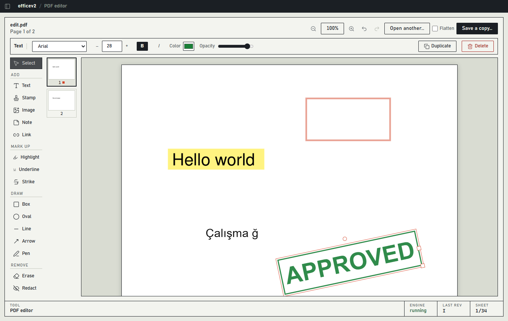
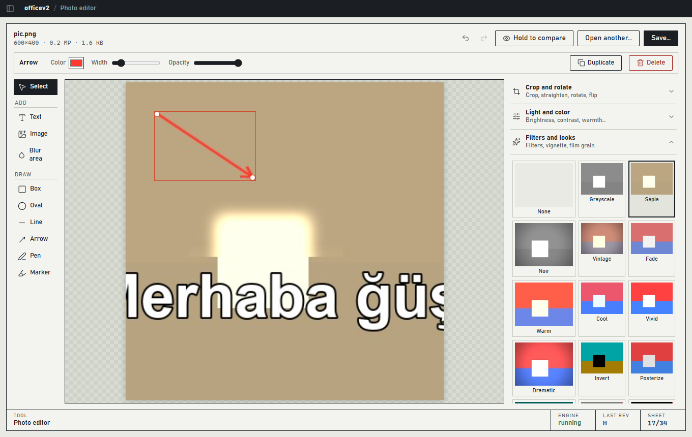
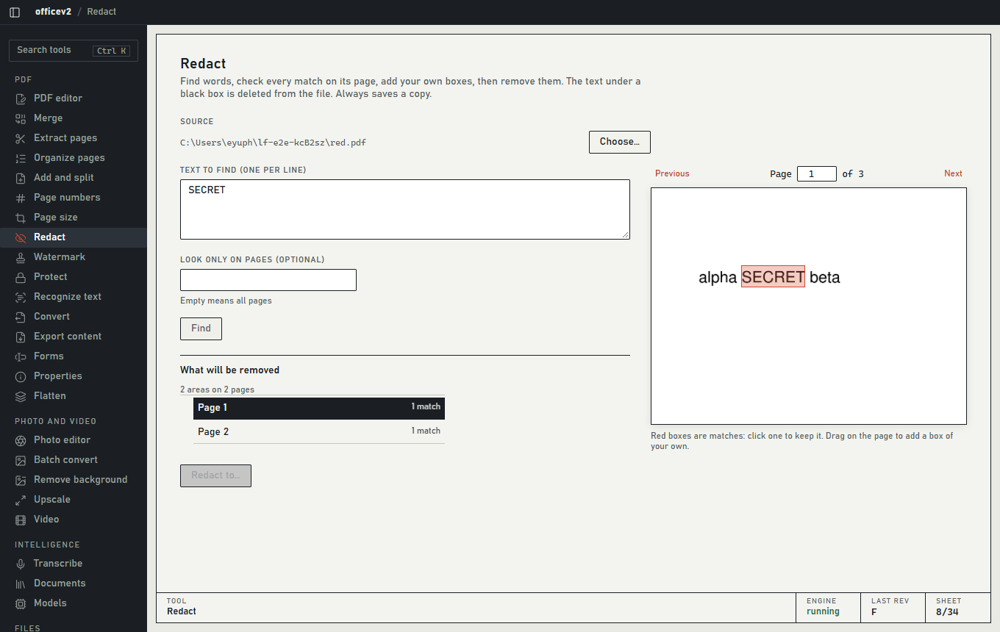
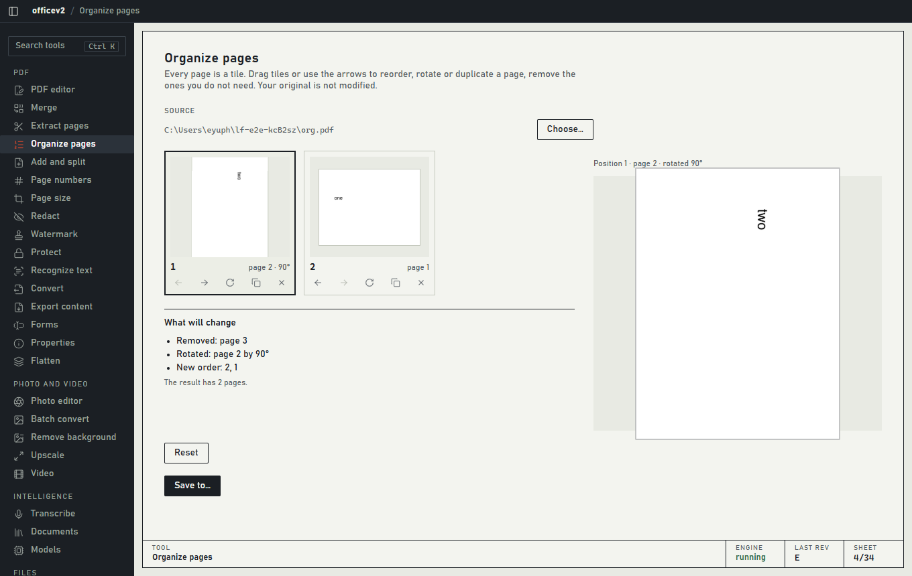
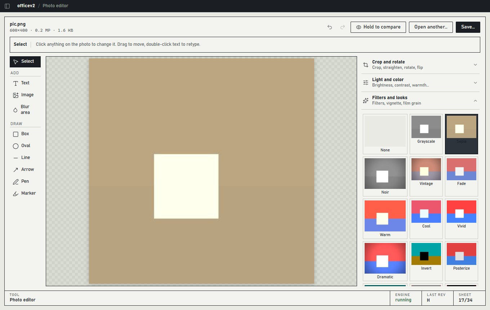

# officev2

**A local-first desktop toolbox for PDFs, photos, files and on-device AI.**
Everything runs on your own computer. No account, no cloud, no telemetry.

[Türkçe](README-tr.md) · [Architecture](ARCHITECTURE.md) · [Design system](DESIGN.md)

officev2 puts the tools people normally scatter across a dozen websites and apps into one window: a real PDF editor, a photo editor, bulk file tools, speech-to-text and document search that run offline. Your files never leave the machine, and nothing destroys your originals: every tool writes a **copy**, and every file operation can be **undone**.



<table>
<tr>
<td></td>
<td></td>
</tr>
<tr>
<td></td>
<td></td>
</tr>
</table>

## What it does

### PDF

| Tool | What you can do |
|---|---|
| **PDF editor** | Add text (any installed font, Turkish letters included), stamps (APPROVED, DRAFT, ...), images and signatures. Highlight, underline, strike through. Draw boxes, ovals, lines, arrows and freehand. Leave notes, add links. Erase or permanently black out content. Everything you place is a live object: click it to select, drag to move, pull the handles to resize or rotate, double-click text to retype it in place. The options of the selected item (or of the tool in use) sit in one bar above the page. Pages scroll one under another; thumbnails mark the pages you changed. Undo and redo, duplicate, copy and paste, arrow-key nudging. |
| **Organize pages** | Every page is a tile: drag to reorder, rotate, duplicate, delete. A plain-language list says exactly what will change. |
| **Merge, Extract pages** | Merge with a page-by-page result map; pick pages from a thumbnail grid or type a range. |
| **Add and split** | Insert blank pages or pages from another PDF; split every N pages, before given pages, or at bookmarks. |
| **Page numbers** | Headers, footers, page numbers and Bates numbers with tokens (`{n}`, `{n:04}`, `{total}`, `{file}`, `{date}`), live preview. |
| **Page size** | Crop margins (manual or automatic) and fit pages onto A3/A4/A5/Letter/Legal. |
| **Redact** | Search, review every match on its page, add your own boxes. The text underneath is removed from the file. |
| **Watermark** | Text or image watermark with a live preview of each page. |
| **Forms** | Fill form fields, optionally flatten. |
| **Properties** | Edit title, author, keywords and the bookmark outline. |
| **Export content** | Pages as PNG/JPG, pictures inside the PDF, text (txt, Markdown, JSON), pictures to PDF. |
| **Protect, Convert, OCR** | AES-256 encryption and unlock (you must know the password), PDF to Word, Office to PDF, compress, metadata cleaner, OCR to a searchable PDF, flatten, grayscale. |

### Photos and video

| Tool | What you can do |
|---|---|
| **Photo editor** | Crop with aspect ratios, rotate, straighten, flip, resize. Exposure, brightness, contrast, highlights, shadows, warmth, tint, saturation, vibrance, hue, sharpness, auto-enhance. 17 filters with live thumbnails, vignette, film grain. Blur, pixelate or tilt-shift **a chosen area** (hide faces or number plates) or blur everything except the subject. Text with outline, shadow and label box; shapes, arrows, pen and marker; logo overlay; border and rounded corners; remove background. Text, shapes, logos and blur areas are live objects on the photo: click to select, drag, resize with handles, rotate, double-click text to retype. Whole-photo tools (crop, light, filters, border, size) sit in a short list of sections on the right. Every change is a step you can remove. Presets, hold-to-compare, undo and redo. |
| **Batch** | Apply the same edits to a whole folder; convert, compress and strip metadata in bulk. |
| **Video, Remove background, Upscale** | ffmpeg conversion, background removal, AI upscaling. |

### Files, AI and everyday tools

- **Files:** bulk rename with preview, cleanup of temp files, developer junk (`node_modules`, caches) and duplicates, disk map, and **Autopilot** rules that sort new downloads. Cleanup never deletes: it moves files to a quarantine folder you can restore from.
- **Intelligence:** speech-to-text (Whisper), chat with and semantic search across your documents (local embeddings; written answers when Ollama is installed), a model manager.
- **Desk:** clipboard history for text and images (password-manager entries are never recorded), color picker, pin an image above your windows, copy text from anywhere on screen.
- **Vault:** an encrypted store (Argon2id + AES-256-GCM) with a recovery key.
- **Tools:** Dev Lab (JWT, JSON, Base64, SQL, timestamps), clean paste for text copied from PDFs, a scratchpad.
- **Everywhere:** a command palette (`Ctrl+K`), an Activity log with undo for every operation, progress bars and cancel for long jobs.

## How it keeps your files safe

- **Originals are never modified.** Tools save a copy and refuse to overwrite an existing file.
- **Everything is undoable.** Created files move to a trash folder, moved or renamed files go back where they were, removed files sit in quarantine.
- **The engine is private to the app.** The Python engine listens only on `127.0.0.1` on a random port, requires a per-session token, rejects foreign browser origins, and only touches folders inside your user profile.
- **Nothing is downloaded behind your back.** Models download on first use; third-party programs (the upscaler) are never fetched automatically.

## Requirements

- Windows 10/11 (the primary and only tested platform)
- Python 3.12, Node.js 22, Rust (stable, MSVC build tools) and WebView2
- Optional: ffmpeg (video, audio), LibreOffice (Office to PDF), Ollama (written answers for document chat)

## Run it

```powershell
git clone https://github.com/beyuphan/officev2.git
cd officev2

# 1. backend
cd backend
python -m venv venv
.\venv\Scripts\python.exe -m pip install -r requirements.txt
cd ..

# 2. app (starts the Python engine itself)
cd frontend
npm install
npm run tauri dev
```

The desktop shell finds the engine at `backend/venv`. Set `LOCALFLOW_BACKEND_DIR` or `LOCALFLOW_PYTHON` to point elsewhere.

| Variable | Purpose |
|---|---|
| `LOCALFLOW_DATA_DIR` | Where settings, history, models and the vault live (default `%APPDATA%\officev2`) |
| `LOCALFLOW_ALLOWED_ROOTS` | Folders the engine may read and write (default: your user profile) |
| `LOCALFLOW_TOKEN` | Set by the shell; for a standalone engine use `LOCALFLOW_DEV_TOKEN` |

Standalone engine for development:

```powershell
cd backend
$env:LOCALFLOW_DEV_TOKEN = "dev"
.\venv\Scripts\python.exe -m uvicorn main:app --host 127.0.0.1 --port 8000
```

## Tests

```powershell
cd backend;  .\venv\Scripts\python.exe -m pytest -m "not network"   # engine: 138 tests (141 with model downloads)
cd frontend; npm test                                              # logic: 51 tests
cd frontend; npm run test:e2e                                      # real engine + real UI in Edge: 65 checks
cd frontend\src-tauri; cargo test --lib                            # clipboard store: 9 tests
```

The end-to-end suite drives the actual interface (file dialogs are mocked), saves real files and then opens them again to check the result: text that was added is searchable, redacted text is gone, a rotated page numbers upright, a cropped photo has the right size.

## Project layout

```
backend/    Python engine (FastAPI): PDF, photo, media, AI, files, vault, jobs, history
frontend/   Tauri 2 shell (Rust) + React/TypeScript UI, end-to-end tests in e2e/
docs/       Screenshots
```

See [ARCHITECTURE.md](ARCHITECTURE.md) for how the pieces fit together.

## Status and limits

- Windows only so far. Clipboard, color picker, screen capture and Windows OCR are Windows-specific.
- Run from source: the Python engine is not yet bundled into an installer.
- The PDF editor **adds** content. It does not rewrite the existing text of a PDF. Image signatures work; cryptographic digital signatures are not implemented.
- OCR uses Windows OCR when a language pack is installed (accurate for Turkish) and falls back to a bundled engine that drops Turkish diacritics.
- The AI upscaler is a third-party program you install explicitly from the Models screen; it is not checksum-pinned yet.
- Clipboard history is stored as plain data in a local database (not encrypted yet).
- Screen text capture, pin-to-screen and the color picker are covered by unit tests and mocked commands, not by driving the real overlay windows.
- Not built yet: LocalDrop (send files on the local network), the one-click local exposer, macOS and Linux.

## Roadmap

1. Installer with the engine bundled
2. LocalDrop
3. Encrypted clipboard history
4. Real-window tests for the screen tools
5. Semantic search over photos

## License

No license has been chosen yet; all rights reserved for now.
